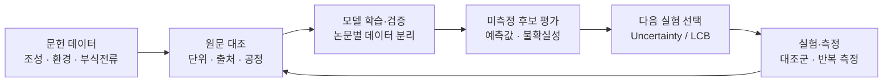

<div align="center">

# REE_AL

**Active Learning for Rare-Earth Alloy Corrosion**

희토류 첨가 합금의 문헌 데이터를 바탕으로 다음 실험 조건을 선택하는 연구 코드

[빠른 시작](#빠른-시작) · [연구 흐름](#연구-흐름) · [평가 결과](#평가-결과) · [VAE 가이드](VAE_GUIDE.md) · [데이터 검증](audit/REPORT.md)

</div>

---

## 프로젝트 개요

REE_AL은 **문헌 데이터 검증 → 부식 예측 → 불확실성 기반 후보 선택 → 실측 결과 갱신**을 연결합니다. 희토류 종류·함량, 합금 조성, 시험 환경과 공정 조건을 사용해 부식전류밀도를 예측하고, 제한된 실험 예산에서 다음에 측정할 후보를 선정합니다.

| 데이터 규모 | 원문 검토 범위 | 예측 목표 | 후보 선택 |
| :--- | :--- | :--- | :--- |
| **304개 기록 · 48개 출처** | **20편 · 174개 기록** | `log10(icorr_A_cm2)` 최소화 | Random · Uncertainty · LCB |

현재 구현은 문헌 기반의 **연구용 기준선과 비교 실험**입니다. 원문 검토는 논문별 방법·표·그림의 확인 범위가 다르며, 304개 기록 전체가 검증 완료된 것은 아닙니다. VAE와 active learning의 성능 우위 역시 현재 실험에서는 확인되지 않았습니다.

## 연구 흐름



| 구성 | 구현 내용 |
| :--- | :--- |
| **Data curation** | 원본 보존, 출처별 검토 상태, 셀별 수정 근거와 입력 파일 해시 기록 |
| **Grouped evaluation** | 논문 단위 홀드아웃, 학습 데이터 내부 GroupKFold, fold별 전처리 |
| **Model comparison** | Random Forest, Extra Trees, 부스팅, Ridge, SVR, VAE + 회귀 |
| **Active learning** | 동일 초기 집합에서 선택 전략 비교, 후보 중복 제거, 다음 배치 출력 |
| **Uncertainty estimation** | 기본 RF의 트리 간 편차 또는 논문 bootstrap 위원회 예측 편차 |

## 빠른 시작

Python **3.10 이상**에서 실행합니다. 프로젝트 디렉터리에서 원하는 Python 환경을 활성화한 뒤 설치하십시오.

```powershell
python -m pip install -r requirements.txt
```

### 1. 정제 데이터로 모의 active learning 실행

```powershell
python active_learning.py simulate --data data/curated_corrosion.csv --with-process --output outputs/curated_al
```

기본 설정은 **초기 40개 → 회차별 5개 추가 → 8회 반복**, seed `42, 43, 44`입니다. 각 seed에서 세 전략은 같은 초기 집합과 논문 홀드아웃을 사용합니다. 기존 기록은 모두 레이블이 있으므로, 미선택 레이블을 숨겨 획득 과정을 재현합니다.

빠른 동작 확인:

```powershell
python active_learning.py simulate --data data/curated_corrosion.csv --with-process --seeds 42 --rounds 2 --output outputs/smoke
```

### 2. 모델 비교와 최종 학습

```powershell
python improve_models.py --fit-final --output outputs/model_selection
```

학습 논문 내부의 교차검증으로 설정을 선택한 뒤 고정된 외부 논문 홀드아웃에서 평가합니다. `--fit-final`은 평가 후 전체 입력 데이터로 별도의 CV와 재학습을 수행해 `final_model.joblib`과 `final_config.json`을 저장합니다. 이 최종 모델 자체에 독립 테스트 점수가 부여되는 것은 아닙니다.

### 3. VAE까지 비교

PyTorch는 선택적 의존성입니다. CPU 실행 환경은 다음과 같이 설치할 수 있습니다.

```powershell
python -m pip install torch --index-url https://download.pytorch.org/whl/cpu
python improve_models.py --include-vae --fit-final --output outputs/model_selection_vae
```

VAE 구조, 손실, 결측 처리와 생성 모델로 확장하는 방법은 [VAE_GUIDE.md](VAE_GUIDE.md)에 설명했습니다.

## 실험 후보 추천

`candidates.csv`는 **실제로 제조·측정할 수 있는 미측정 조건**으로 작성합니다. 현재 코드는 후보 공간을 임의로 생성하지 않습니다.

| 후보 데이터 | 작성 기준 |
| :--- | :--- |
| `record_id` | 고유 ID. 학습 기록과 중복 불가 |
| 기본 입력 | 조성·시험 조건의 수치 15개와 범주 3개 |
| 공정 입력 | 고급 추천 또는 `--with-process` 사용 시 `PROCESS_NUM`, `PROCESS_CAT` 열 추가 |
| 미보고 값 | 빈칸 유지. 미보고 조성을 임의로 0으로 입력하지 않음 |
| `icorr_A_cm2` | 열을 생략하거나 전부 빈칸으로 유지 |

정확한 입력 열 목록은 [active_learning.py](active_learning.py)의 `NUM`, `CAT`, `PROCESS_NUM`, `PROCESS_CAT`에 정의돼 있습니다. 상분율은 기본적으로 제외하며, 후보 선택 시점에 알 수 있는 신뢰할 만한 값을 확보한 경우에만 `--with-phase`로 사용합니다.

**선택 모델과 논문 bootstrap 위원회로 LCB 추천:**

```powershell
python recommend_advanced.py --candidates candidates.csv --config outputs/model_selection/final_config.json --committee 5 --beta 1.0 --output outputs/round01
```

**VAE + 회귀를 사용한 비교 실험:**

```powershell
python recommend_advanced.py --candidates candidates.csv --config configs/vae.json --committee 5 --output outputs/vae_round01
```

**기본 Random Forest만 사용하는 경우:**

```powershell
python active_learning.py recommend --data data/curated_corrosion.csv --with-process --candidates candidates.csv --strategy uncertainty --batch-size 5 --output outputs/rf_round01
```

결과는 `ranked_candidates.csv`와 `next_batch.csv`로 저장합니다. 같은 입력 조합은 중복 제거하며, 비교 시 수치를 소수점 10자리로 반올림합니다. 모델 입력에 포함되지 않은 공정 차이는 구분할 수 없습니다. 반복 측정 대조군은 별도 실험 계획으로 관리하십시오.

## Exploration & Exploitation

모델은 로그 척도의 부식전류를 예측하며, 낮은 값의 후보를 찾습니다.

$$
y = \log_{10}(i_{\mathrm{corr}}), \qquad
\alpha_{\mathrm{LCB}}(x) = \mu_y(x) - \beta\,\sigma_y(x)
$$

| 전략 | 선택 기준 | 역할 |
| :--- | :--- | :--- |
| **Random** | 무작위 비복원 추출 | 같은 실험 예산의 기준선 |
| **Uncertainty** | 예측 표준편차가 큰 순서 | 예측이 불확실한 조건 탐색 |
| **LCB** | `μ − βσ`가 작은 순서 | 낮은 전류 예측과 탐색의 절충 |

`β = 0`이면 예측값이 낮은 후보를 우선하고, `β`를 높이면 불확실한 후보에 더 큰 가중치를 부여합니다. 현재 표준편차는 **보정된 신뢰구간이나 측정 오차가 아닙니다.** `β = 2`를 95% 신뢰수준으로 해석할 수 없으며, 데이터 범위 밖에서도 불확실성이 작게 나올 수 있습니다.

VAE의 잠재변수 분산과 부식전류의 예측 불확실성은 구분합니다. 고급 추천에서는 VAE·회귀를 포함한 모델 전체를 논문 bootstrap으로 다시 학습하고, 위원회가 예측한 **부식전류의 편차**를 사용합니다. 역변환 `10**μ`는 기하 척도 예측이며 원 단위의 산술 평균 예측은 아닙니다.

## 평가 결과

### 전체 학습 데이터 · 논문 홀드아웃

seed `42, 43, 44`의 점수를 단순 평균했습니다. 모든 지표는 **log10 목표 기준**이며, 아래 행들은 같은 외부 테스트 ID를 사용합니다.

| 데이터·모델 | 평균 테스트 R² | 평균 RMSE | 평균 MAE |
| :--- | ---: | ---: | ---: |
| 원본 데이터 · 고정 RF | −0.2345 | 1.0936 | 0.9190 |
| 정제 데이터 + 공정 · 고정 RF | **0.0374** | **0.9706** | 0.8339 |
| 내부 논문 CV로 모델·입력 선택 | 0.0346 | 0.9790 | **0.8148** |
| VAE 계열 내부 CV 선택 | −0.4391 | 1.1945 | 0.9790 |

원문 대조 후 평균 성능은 개선됐지만, 추가 모델 탐색에서는 R²·RMSE의 추가 개선을 확인하지 못했습니다. VAE도 이번 소형 구조와 학습 설정에서는 기준선을 넘지 못했습니다. 기존 테스트 분할은 개발 과정에서 재사용했으므로 최종 연구 주장에는 새로운 독립 실험 데이터가 필요합니다.

자세한 seed별 결과와 평가 조건은 [데이터 정제 보고서](audit/REPORT.md), [추가 모델 비교 보고서](audit/MODEL_REPORT.md)를 참조하십시오.

<details>
<summary><strong>원본 데이터의 active learning 기준 실험 보기</strong></summary>

초기 40개에서 5개씩 8회 추가해 80개를 학습한 모의 실험입니다. 위의 전체 학습 예산 결과와 구분해야 합니다.

| 전략 | 80개 학습 후 MAE | RMSE | R² |
| :--- | ---: | ---: | ---: |
| Random | 0.8596 | 1.0252 | −0.0740 |
| Uncertainty | 0.9841 | 1.2211 | −0.5468 |
| LCB | 0.9706 | 1.1998 | −0.5597 |

이 설정에서는 Random이 더 좋았으며 active learning의 우위는 확인되지 않았습니다. 정제 데이터에서도 80개 학습 조건의 개선은 확인되지 않았습니다. 실제 최적화 성능은 동일 환경 내 최저 실측 전류, 대조군 대비 개선과 반복성도 함께 평가해야 합니다.

</details>

## 데이터와 검증 범위

| 파일 | 역할 |
| :--- | :--- |
| `rare_earth_steel_single_sheet_sources.xlsx` | 원본. `ENRICHED_DATA` 시트, 304개 기록·48개 출처 |
| [data/curated_corrosion.csv](data/curated_corrosion.csv) | 원본 행과 부식전류 목표값을 유지한 보수적 정제본 |
| [audit/paper_review.csv](audit/paper_review.csv) | 논문별 검토 범위와 미해결 사항 |
| [audit/changes.csv](audit/changes.csv) | 셀별 변경 전후 값, 원문 위치와 이유 |
| [audit/access_inventory.csv](audit/access_inventory.csv) | 출처 접근 상태와 대체 원문 확보 여부 |

정제본의 `paper_review_scope`, `target_review_status`로 검토 수준을 확인합니다. **28편·130개 기록은 원문 검증 미완료**이며, 그림 유래 값과 원문 내 수치·단위 불일치도 별도로 표시했습니다. 상분율에는 추정값이 포함돼 있어 숫자가 채워졌다는 사실만으로 실측값으로 취급하지 않습니다.

원본 XLSX는 `.gitignore` 대상이므로 저장소를 새로 복제한 경우 별도로 준비해야 합니다. 이미 제공된 정제 CSV로는 위 빠른 시작을 실행할 수 있습니다.

원본에서 정제와 평가를 재현하려면:

```powershell
python curate_data.py
python evaluate_curation.py
```

## 실험 운영 원칙

1. **실험 범위를 먼저 정의합니다.** 강종·전해질·농도 기준·온도·공정을 통제하고 바꿀 인자를 정합니다. 테스트 점수를 확인한 뒤 유리한 행만 제외하지 않습니다.
2. **평가 논문을 분리합니다.** 전처리와 모델 선택은 학습 데이터 내부에서 수행합니다. 서로 다른 논문이 같은 원자료를 재사용했다면 원자료 단위로 그룹을 통합해야 합니다.
3. **후보의 제조 가능성을 확인합니다.** 조성 범위·질량 수지·비용·공정 제약을 검토합니다. 현재 코드에는 배치 내 다양성 최적화나 완전한 외삽 검출이 구현돼 있지 않습니다.
4. **실측 결과만 학습 데이터에 추가합니다.** 추천 파일의 예측값을 정답으로 복사하지 않습니다. 완료·진행 중·실패 후보를 다음 미측정 풀에서 구분하고 대조군·반복 측정을 확보합니다.
5. **중단 기준을 사전에 정합니다.** 예산, 목표 전류, 반복 측정 변동 대비 개선 한계를 정하고 최종 독립 실험으로 확인합니다.

## 저장소 구성

```text
REE_AL/
├── active_learning.py       # RF 기반 모의 AL 및 후보 추천
├── curate_data.py           # 원문 근거에 따른 정제 규칙
├── evaluate_curation.py     # 동일 분할의 정제 전후 비교
├── improve_models.py        # 논문별 내부 CV와 모델 선택
├── regression_models.py     # 전처리·추가 입력·모델 구성
├── vae_regressor.py         # Mixed-data VAE + 회귀
├── recommend_advanced.py    # 논문 bootstrap 위원회 추천
├── fetch_papers.py          # 원문·표·공개 XML 수집
├── configs/                 # VAE 비교 설정
├── data/                    # 정제 데이터
├── audit/                   # 검토 이력과 연구 보고서
├── tests/                   # 검증 코드
├── outputs/                 # 실행 결과·모델·원문 캐시, Git 제외
└── VAE_GUIDE.md             # VAE 방법론과 실행 가이드
```

## 결과 파일과 재현

| 실행 | 주요 산출물 |
| :--- | :--- |
| 모의 AL | `learning_curves.csv`, `queries.csv`, `splits.csv`, `summary.csv`, `run.json` |
| 모델 비교 | `training_cv.csv`, `metrics.csv`, `predictions.csv`, `search_space.json`, 저장 모델 |
| 후보 추천 | `ranked_candidates.csv`, `next_batch.csv`, `run.json` |

실행마다 다른 `--output` 경로를 사용하면 기존 결과를 보존할 수 있습니다. 같은 경로의 파일은 덮어씁니다. 기록된 해시·옵션·seed와 논문 분할을 함께 보존하십시오. 기본 3개 seed만으로 전략의 통계적 우위를 판단하지 않습니다.

```powershell
python -m unittest discover -s tests -v
```

검증 항목에는 목표값 보존, 원문 정제 규칙, 논문 분리, 후보 중복 제거, 농도 기준 처리, fold별 전처리와 선택적 VAE의 결측·미지 범주 처리가 포함됩니다. 과거 `test.py`는 현재 없는 `ML_FINAL.xlsx`를 참조하는 별도 실험 스크립트이며, 위 실행 진입점을 사용합니다.

## 방법론 참고

- [Auto-Encoding Variational Bayes](https://arxiv.org/abs/1312.6114) — VAE의 잠재분포와 재매개화.
- [scikit-learn GroupKFold](https://scikit-learn.org/stable/modules/generated/sklearn.model_selection.GroupKFold.html) — 논문별 내부 교차검증.
- [scikit-learn GroupShuffleSplit](https://scikit-learn.org/stable/modules/generated/sklearn.model_selection.GroupShuffleSplit.html) — 그룹 단위 홀드아웃.
- [scikit-learn RandomForestRegressor](https://scikit-learn.org/stable/modules/generated/sklearn.ensemble.RandomForestRegressor.html) — 기본 회귀 모델.
- [scikit-learn SimpleImputer](https://scikit-learn.org/stable/modules/generated/sklearn.impute.SimpleImputer.html) — 결측 대치와 결측 지시자.
