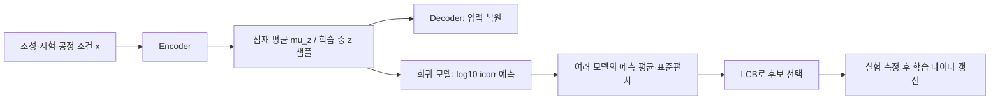

# VAE를 이용한 부식 예측과 active learning

현재 데이터에서는 **VAE를 비교 실험용 표현 학습 모델로 사용하는 것**부터 시작하는 편이 타당합니다. 304행을 VAE로 증식한다고 독립적인 실측 정보가 늘어나는 것은 아닙니다. 이번에 작은 VAE와 감독 신호를 추가한 VAE를 구현해 논문별 검증까지 실행했습니다. 현재 구현에서는 VAE가 기존 random forest보다 좋지 않았으며, 이를 이유로 모든 VAE 방식이 불가능하다고 결론 내리지는 않습니다. [프로젝트 비교 결과](audit/MODEL_REPORT.md)

## VAE가 하는 일

입력 `x`는 조성, 전해질, 온도, 시간, 공정 조건입니다. Encoder가 이를 저차원 잠재벡터의 평균 `mu_z`와 로그분산 `logvar_z`로 바꿉니다. 학습 중에는 `z = mu_z + exp(0.5*logvar_z)*epsilon`으로 표본을 뽑고 Decoder가 원래 입력을 복원합니다. 복원 손실과 잠재분포의 KL 항을 함께 최소화하는 방식입니다. [VAE 원 논문](https://arxiv.org/abs/1312.6114)



VAE만으로 부식전류를 예측하는 회귀기가 자동으로 만들어지지는 않습니다. 이번 구현은 다음 두 방식을 비교합니다.

| 방식 | 학습 | 최종 부식 예측 |
| --- | --- | --- |
| VAE + Ridge | 입력 복원 + KL로 Encoder 학습 | Encoder의 잠재 **평균**을 표준화해 Ridge 회귀 |
| 감독 신호를 추가한 VAE + Ridge | 입력 복원 + KL + 잠재 평균에서 부식전류를 예측하는 보조 head 손실 | 동일하게 잠재 평균 + Ridge. 보조 head는 표현 학습에만 사용 |

두 방식 모두 정답 `y`는 Encoder 입력에 포함하지 않습니다. 예측 시 정답을 요구하지 않으며, 테스트 입력이나 레이블로 VAE를 사전학습하지 않습니다.

## 현재 코드의 구체적인 구성

- Encoder: `입력 → 32 → 16 → 잠재 2 또는 4차원`. Decoder는 반대 방향의 작은 MLP입니다.
- 수치 입력: 학습 fold의 중앙값으로 입력만 대치하고 표준화합니다. 결측 마스크를 Encoder에 함께 넣습니다. **원래 결측인 수치는 복원 손실에서 제외**해 대치값을 실측 정답으로 가르치지 않습니다.
- 범주 입력: 학습 fold에서 one-hot 인코딩합니다. Decoder는 범주별 logits를 출력하고 cross entropy로 복원합니다. 범주 결측은 별도 `missing` 상태입니다. 예측 시 미지 범주는 all-zero로 인코딩합니다.
- 손실: `수치의 관측 위치 평균제곱 복원오차 + 범주별 평균 cross entropy + beta_kl * KL + supervised_weight * 표준화된 y의 보조 예측 MSE`.
- 수치 손실과 범주 손실을 각각 정규화해 더하는 실용적 mixed-data 목적함수입니다. 모든 측정의 오차 분포까지 추정한 물리적 확률모델이나 엄밀히 보정된 단일 likelihood라고 해석하지 않습니다.
- `beta_kl=0.02`, 처음 30 epoch 동안 KL 가중치를 증가시킵니다. 150 epoch, Adam, weight decay와 gradient clipping을 사용합니다. epoch와 손실 가중치는 이번 비교에서 고정했습니다.
- 비감독 VAE는 잠재 2/4차원, 감독 보조 손실 모델은 잠재 4차원·`supervised_weight=1`을 비교했습니다. 모델 크기나 epoch를 광범위하게 튜닝한 결과는 아닙니다.

`beta_kl`은 **VAE 학습 정규화 가중치**입니다. 추천 명령의 `--beta`는 **LCB 탐색 가중치**이며 서로 다른 값입니다.

표 데이터에서 신경망이 트리 모델보다 항상 우수한 것은 아닙니다. 관련 벤치마크도 신경망과 트리의 성능을 데이터별로 비교할 필요성을 보여 줍니다. 그 벤치마크는 현재 304개 부식 데이터에 대한 직접적인 성능 보장은 아닙니다. [표 데이터 벤치마크](https://arxiv.org/abs/2207.08815)

## 설치와 비교 실행

기본 모델만 비교할 때는 PyTorch가 필요 없습니다.

```powershell
python -m pip install -r requirements.txt
python improve_models.py --output outputs/traditional_models
```

CPU에서 VAE도 비교하려면 다음과 같이 설치할 수 있습니다. `requirements-vae.txt`도 선택적 의존성 목록으로 제공합니다.

```powershell
python -m pip install torch --index-url https://download.pytorch.org/whl/cpu
python improve_models.py --include-vae --fit-final --output outputs/model_selection
```

외부 논문 홀드아웃을 고정하고, **학습 논문만 사용한 3-fold GroupKFold**에서 27개 모델/입력 설정을 비교합니다. 내부 OOF log10 RMSE로 설정을 선택한 후 외부 테스트를 평가합니다. 전처리·VAE·회귀를 모든 내부 fold에서 새로 학습합니다. [GroupKFold 공식 문서](https://scikit-learn.org/stable/modules/generated/sklearn.model_selection.GroupKFold.html)

`--fit-final`은 평가가 끝난 뒤 제공된 전체 데이터로 별도의 논문별 CV를 수행하고 `final_model.joblib`과 `final_config.json`을 저장합니다. **이 최종 모델 자체의 독립 테스트 점수가 생기는 것은 아닙니다.** 외부 홀드아웃용 모델은 `model_seed42.joblib` 등의 별도 파일입니다. 현재 전체 데이터 CV에서는 VAE가 아닌 기존 기본 입력 random forest가 선택됐습니다.

원문 검증이 끝나지 않은 130개 기록과 그림 유래 값을 그대로 포함한 비교입니다. VAE가 그 문제를 해결했다고 해석하면 안 됩니다. 기존 테스트 분할은 이전 보고서에서 이미 관찰했으므로 이번 결과도 탐색적 비교로 보고, 최종 주장에는 새 실험실 데이터가 필요합니다.

## VAE와 LCB 연결

LCB에는 **부식전류 예측의 평균과 불확실성**이 필요합니다.

`LCB(x) = mean(log10 icorr 예측) - beta * std(log10 icorr 예측)`

Encoder의 `mu_z`와 `sigma_z`는 잠재공간의 분포입니다. 이 중 `sigma_z`를 그대로 부식전류의 예측 표준편차로 넣지 않습니다. Decoder 복원오차도 자동으로 회귀 예측 오차가 되지는 않습니다.

`recommend_advanced.py`에서는 논문 단위 bootstrap으로 여러 학습 집합을 만들고 동일 설정의 모델을 각각 다시 학습합니다. VAE를 사용할 경우 **각 위원의 Encoder와 Ridge를 모두 다시 학습**합니다. 각 위원이 내놓은 log10 부식전류 예측의 평균과 표본 표준편차를 LCB에 사용합니다. 이 표준편차 역시 보정된 95% 신뢰구간은 아닙니다. 모델들이 함께 틀리면 작게 나올 수 있습니다.

```powershell
# 전체 데이터의 학습 CV로 선택한 설정 사용
python recommend_advanced.py --candidates candidates.csv --config outputs/model_selection/final_config.json --committee 5 --beta 1.0 --output outputs/selected_batch

# VAE 방식 자체를 실험적으로 사용
python recommend_advanced.py --candidates candidates.csv --config configs/vae.json --committee 5 --beta 1.0 --output outputs/vae_batch

# 감독 보조 손실이 있는 VAE 사용
python recommend_advanced.py --candidates candidates.csv --config configs/supervised_vae.json --committee 5 --output outputs/svae_batch
```

후보에는 기본 입력과 `active_learning.PROCESS_NUM / PROCESS_CAT`의 모든 열이 필요합니다. 알 수 없는 값은 빈칸으로 둡니다. 목표값은 없거나 비어 있어야 하며, ID는 학습 기록과 달라야 합니다. 새로운 행이라고 해도 같은 입력 조합이면 중복 후보로 제외합니다. 반복 측정 대조군은 별도 계획으로 관리합니다.

출력은 `ranked_candidates.csv`, `next_batch.csv`, `run.json`입니다. `committee_std_log10`, `lcb_log10`과 함께 학습 범위 밖의 수치 개수, 학습 관측이 전혀 없는 입력 개수, 미지 범주 개수를 제공합니다. **각 열의 최소·최대 안에 있어도 조합 자체는 외삽일 수 있습니다.** 이 표시는 제조 가능성 검사나 완전한 OOD 검출이 아닙니다. 소수의 위원 표준편차만으로 극단적인 탐색을 하기보다 대조군과 반복 측정을 포함해 작은 배치부터 진행하십시오.

## VAE로 새 합금을 생성하려면

현재 코드는 **Decoder로 합금 후보를 생성하거나 합성 레이블을 만들어 학습 데이터에 추가하지 않습니다.** 후보 풀은 연구자가 작성합니다. 현재 데이터 규모에서는 우선 이 방식으로 AL을 검증하는 것이 낫다는 판단입니다.

생성 자체를 연구하려면 다음 별도 단계가 필요합니다.

1. **설계 변수와 고정 조건 구분:** RE 함량·종류·변경할 원소만 생성 대상으로 삼고, 전해질·시험 온도·공정은 조건 벡터로 고정하는 conditional VAE 등을 설계합니다. 현재의 모든 입력을 자유롭게 생성하면 서로 다른 환경이 섞인 후보가 나올 수 있습니다.
2. **조성 제약 적용:** 단위부터 통일하고 원소별 제조 범위, RE ppm↔wt.% 변환, 질량 수지와 공정 제약을 적용합니다. 미보고 원소를 0으로 넣어 조성 합계를 맞추면 안 됩니다. 현재 Gaussian 수치 Decoder는 음수·범위 밖 조성을 자동으로 금지하지 않습니다.
3. **생성 품질 검증:** 독립 데이터에서 조건별 분포와 새로운 조합의 제조 가능성을 확인합니다. 학습 데이터 복제만 하는지와 학습 범위 밖의 잘못된 조합을 만드는지 모두 봅니다.
4. **실측으로 레이블 획득:** 생성 후보는 미측정 풀입니다. 예측 부식전류를 진짜 정답으로 취급해 다시 학습하면 개선을 입증할 수 없습니다. 후보 선택 후 실험·시뮬레이션 등 정당한 oracle로 반응값을 얻습니다.

미측정 조성 데이터가 추가로 충분히 있다면 Encoder의 비감독 학습에 사용할 수 있습니다. 이 경우에도 평가용 논문·실험의 입력까지 사용하는 전이적 평가와, 평가 입력을 전혀 보지 않는 귀납적 평가를 구분해 보고해야 합니다. 현재 구현은 후자입니다.
