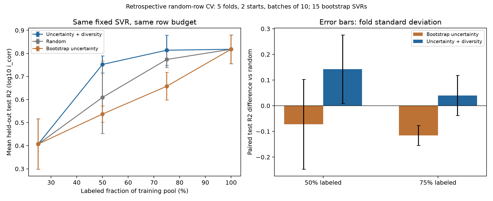

# SVR 기반 Active Learning · 무작위 평가

## 결과

모든 수치는 **고정된 무작위 테스트셋의 log10(i_corr) R²**입니다. 각 fold 안에서 두 초기 seed를 평균한 뒤 5개 fold를 평균했습니다.

| 학습 풀 조회 비율 | 평균 조회 행 수 | 무작위 선택 | 불확실성만 | 불확실성 + 다양성 |
|---|---:|---:|---:|---:|
| 25% · 공통 시작 | 56.0 | 0.4072 | 0.4072 | 0.4072 |
| 50% | 112.0 | 0.6094 | 0.5373 | **0.7522** |
| 75% | 168.0 | 0.7737 | 0.6578 | **0.8137** |
| 100% | 223.2 | 0.8178 | 0.8178 | 0.8178 |

하이브리드의 무작위 대비 차이는 50%에서 **+0.1428**, 75%에서 **+0.0401**입니다. 두 시점 모두 seed를 평균한 5개 fold 중 4개에서 더 좋았습니다. 모든 fold에서 우세하거나 다른 자료에서도 같은 개선을 보장하는 결과는 아닙니다. 불확실성만 사용한 전략은 이 실험에서 무작위보다 낮았습니다.

하이브리드의 평균 RMSE는 50%에서 0.5968, 75%에서 0.5061 log10이며, 무작위는 각각 0.7530, 0.5707입니다. 하이브리드의 fold 간 R² 표준편차는 50%에서 0.0369, 75%에서 0.0652입니다.

75% 조회에서 전체 자료 종점 0.8178에 근접했습니다. 여기서 확인한 이점은 **같은 모델에 적은 수의 정답을 제공했을 때의 데이터 효율**입니다. 학습 풀 전체를 공개하면 세 전략은 같은 데이터·같은 중앙 SVR을 쓰므로 끝점이 같습니다. 0.8137을 보고 테스트 점수 기반으로 조기 종료한 것은 아니며 100%까지 모두 실행했습니다.

네 체크포인트의 사다리꼴 면적을 조회 비율 구간 0.75로 나눈 곡선 요약값은 하이브리드 0.7261, 무작위 0.6652, 불확실성 0.6025입니다. 이는 네 지점으로 근사한 데이터 효율 요약이며 별도 테스트 R²가 아닙니다.



## 실험 방식

기존에 선택한 **환경 변수화 + SVR(C=10, epsilon=0.15)**을 고정하고 Active Learning을 연결했습니다. 예측은 알려진 학습 데이터 전체로 학습한 중앙 SVR이 담당하며, 후보 선택용 불확실성은 같은 학습 행을 복원 추출한 **15개 SVR의 예측 표준편차**입니다. 부트스트랩마다 모델을 다시 학습하지만 전처리는 그 시점의 알려진 학습 자료로 맞춘 것을 공유합니다. 조성 보완 불확실성 전체나 보정된 신뢰구간을 뜻하지 않습니다.

- 데이터: 기존 조성 보완본 279행. 미검토 문헌 후보는 합치지 않았습니다.
- 테스트: 앞선 무작위 학습과 동일한 KFold(5, shuffle=True, random_state=42). 테스트 행은 후보 풀에서 제외합니다.
- 시작: 각 fold의 학습 풀 중 25%를 seed 42·43으로 선택합니다. 세 전략은 같은 시작 자료를 공유합니다.
- 조회: **개별 관측값을 10개씩** 선택합니다. 중간 평가 지점인 학습 풀 50%·75%·100%에 맞출 때만 마지막 배치를 줄입니다.
- 전략: random, uncertainty, diverse_uncertainty. 하이브리드는 불확실성 순위와 입력 공간 거리 순위를 50:50으로 결합하고 배치 내 다양성을 갱신합니다. 가중치를 테스트 점수로 조정하지 않습니다.
- 매 조회 후 조성 donor·결측 대체·스케일링·인코딩·모델을 현재까지 조회한 행만으로 다시 학습합니다. 미조회 행의 정답 열은 획득 함수에 전달하기 전에 제거합니다.
- 같은 체크포인트에서 세 전략의 조회 행 수는 동일합니다. 시작점과 전체 자료 사용 종점도 일치하는지 검사합니다.

이는 **이미 측정된 데이터의 정답을 가리고 순차적으로 공개하는 회고적 모의실험**입니다. 실제로 새 부식 실험을 수행한 결과는 아닙니다. 모델 종류는 앞선 개발 데이터로 선택했으므로 독립적인 외부 검증도 아닙니다.

앞서 보고한 평균 R² 0.7973은 18개 구성의 내부 선택 절차 점수입니다. 이번 AL의 종점은 고정 환경 SVR의 점수이며, 이를 서로 빼서 AL 개선이라고 해석하지 않습니다. AL 효과는 **같은 고정 SVR·같은 데이터 수에서 무작위 선택 대비 차이**로 봅니다.

## 실행

```powershell
python -m corrosion_ml al simulate
python -m corrosion_ml al recommend --candidates candidates.csv --strategy diverse_uncertainty --batch-size 5
python -m corrosion_ml predict --data candidates.csv
python -m unittest discover -s tests -v
python -m corrosion_ml plot
```

추천 후보는 data/templates/candidates.csv 헤더를 사용합니다. 고유 record_id를 넣고 icorr_A_cm2는 빈칸으로 둡니다. 알려진 핵심 조성이 최소 2개 필요하며 기존 관측과 동일한 조건, 중복 후보는 제외합니다. 실제로 측정 가능한 조건인지 검토한 후보 풀을 입력해야 합니다. 관측이 끝난 값이나 모델 예측을 미측정 실험 정답으로 대입하지 않습니다.

현재 실제 미측정 후보 파일은 제공되지 않아 신규 실험 목록을 임의로 만들지 않았습니다. recommend 명령은 최신 학습 자료 전체로 SVR 위원회를 학습하고 후보를 평가합니다. 결과는 results/queries/next_batch.csv와 scored_candidates.csv입니다.

## 파일

learning_curves.csv는 fold·초기 seed·전략별 체크포인트 점수, queries.csv는 실제 모의 조회 순서, splits.csv는 고정 테스트 행, predictions.csv는 평가 예측입니다. summary.csv는 초기 seed를 fold 안에서 평균한 뒤 5개 fold를 요약합니다. 표준편차는 fold 간 변동이며 95% 신뢰구간이 아닙니다. paired_differences.csv는 동일 fold에서 무작위 대비 R² 차이입니다.

모의실험 완료 후 models/svr.joblib에 279행 전체로 학습한 중앙 SVR·부트스트랩 위원회·전처리를 저장합니다. 그 학습 점수를 테스트 점수로 보고하지 않습니다. CSV는 전부 Git에서 제외합니다.

검증 완료: 테스트 21개 통과, 체크포인트 점수 120개, 모의 조회 5,016건, 평가 예측 6,696개를 확인했습니다. 기존 무작위 평가와 테스트 행이 같고, 조회는 학습 풀 안의 중복 없는 행이며, 전체 자료 종점은 독립적으로 다시 학습한 기존 환경 SVR 파이프라인과 일치했습니다. 저장 모델의 별도 프로세스 예측도 확인했습니다. 세부 항목은 validation.json에 있습니다.
